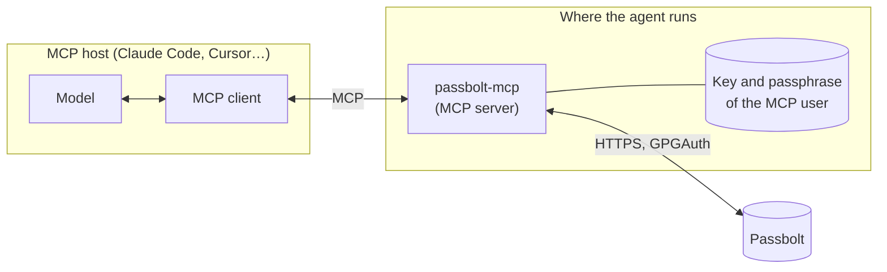
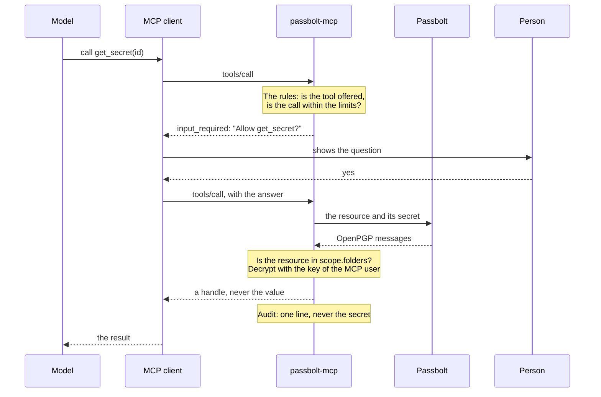

# Architecture overview

This page explains how passbolt-mcp fits between an AI application and Passbolt: who takes part,
what limits the agent, which MCP features passbolt-mcp offers, and what happens during a call.

## Participants

passbolt-mcp follows the client-server architecture of MCP. An **MCP host**, the AI application,
creates an **MCP client** that connects to passbolt-mcp, the **MCP server**. passbolt-mcp in turn
connects to Passbolt as an ordinary user.

- **MCP host**: the AI application the person works in, such as Claude Code, Claude Desktop,
  Cursor or VS Code.
- **MCP client**: the part of the host that holds the connection to passbolt-mcp. It lists the
  tools for the model, sends the calls, and shows the person the questions of passbolt-mcp.
- **MCP server**: passbolt-mcp. It runs where the agent runs, started by the client (stdio) or
  listening on a loopback address (Streamable HTTP).
- **The MCP user**: a Passbolt user created for the agent, with the role `user` and an OpenPGP key
  of its own. passbolt-mcp logs in as this user, never as a person.
- **Passbolt**: your Passbolt server, unchanged. It knows the MCP user as any other user.

## Two barriers

What the agent can do is limited twice, and it only gets what **both** barriers allow.

| Barrier | Set by | Limits |
|---|---|---|
| **The MCP user**, in Passbolt | The administrator and the owners of the resources | What the agent can **see**: only the resources and folders shared with the MCP user or its groups, with the permission given (read, update, owner). |
| **The MCP rules**, in passbolt-mcp | Whoever runs passbolt-mcp, in its configuration file | What the agent can **do**: which tools it gets, whether it may read secrets, write or share, in which folders, how often, and which calls a person must approve. |

A rule can only take away. It never gives more than Passbolt does: a resource shared as **Read**
stays read only, whatever the rules say. And removing a share in Passbolt cuts the agent off at
once, without touching passbolt-mcp.

On top of the two barriers, a person can stay in the loop. With [`[confirm]`](rules.md#confirm-what-the-person-says-yes-to),
the tools you list run only after the person says yes in the client.

## What passbolt-mcp offers over MCP

MCP defines the features a server can offer. passbolt-mcp uses four of them.

| MCP feature | What passbolt-mcp offers | Controlled by |
|---|---|---|
| **Tools** | Up to 31 functions the model can call: find and read resources, read or use secrets, write, share. See [Tools](tools.md). | The rules: a tool the rules refuse is not even listed. |
| **Resources** | `passbolt://resource/{id}` and `passbolt://folder/{id}`, the metadata of a resource or a folder, never a secret. | `scope.folders`. |
| **Prompts** | `audit_password_hygiene` and `rotate_password`, ready-made tasks a person can start from the client. | The rules: `rotate_password` needs `write` and `secrets`. |
| **Elicitation** | The questions of [`[confirm]`](rules.md#confirm-what-the-person-says-yes-to): passbolt-mcp asks the person, through the client, before a sensitive call runs. | `[confirm]`. |

passbolt-mcp supports the protocol versions `2025-11-25` and `2026-07-28`. With `2026-07-28`, a
question goes back to the client as an `input_required` result; with earlier versions, as an
`elicitation/create` request during the call.

## Transports

| Transport | When | How |
|---|---|---|
| **stdio** | The default. The client starts passbolt-mcp and talks to it on stdin and stdout. | One client per process. |
| **Streamable HTTP** | For a client that cannot start a process, or several clients at once. | `passbolt-mcp serve --http 127.0.0.1:8808`. A loopback address only; requests from a web page, which carry an `Origin` header, are refused. |

## Lifecycle

1. **Verify, once.** `passbolt-mcp verify` pins the OpenPGP key of the server. At each later login,
   the server must prove it holds the matching private key.
2. **Start.** The client starts passbolt-mcp. It reads its configuration, decrypts the private key
   of the MCP user with its passphrase (from a file or a command), and logs in with GPGAuth. It
   refuses to run if the MCP user is an administrator.
3. **Serve.** It answers the calls of the agent. When the Passbolt session expires, it logs in
   again on its own.
4. **Stop.** When the client closes the connection, or on Ctrl-C or `SIGTERM`, it logs out.

## What happens during a call

Here is what happens when the agent calls `get_secret` on a resource, with `[confirm]` listing
`get_secret`.

1. **The rules.** passbolt-mcp checks that the rules offer the tool and that the call stays within
   `[limits]`. A refused call returns an error that names the rule.
2. **The person.** If `[confirm]` lists the tool, passbolt-mcp asks the person through the client.
   The model never sees the question and cannot answer it.
3. **Passbolt.** passbolt-mcp fetches what it needs as the MCP user. Passbolt returns only what is
   shared with that user.
4. **The scope.** passbolt-mcp checks that the resource is inside `scope.folders`, and refuses it
   otherwise, even when Passbolt shares it.
5. **Decryption.** passbolt-mcp decrypts the metadata and the secret on its side, with the key of
   the MCP user. Nothing is decrypted on the server.
6. **The answer.** The agent gets a handle instead of the value, unless the operator sets
   `access.reveal_secrets`: see
   [Use a secret without seeing it](secrets-without-seeing.md).
7. **The audit.** One JSON line records the tool, the ids it named and the outcome, never a secret.

## Next steps

- [Security](security.md): the attacks this architecture faces, and their mitigations.
- [Rules](rules.md): every key of the configuration.
- [The MCP user](guides/mcp-user.md): create it, share with it, revoke it.
