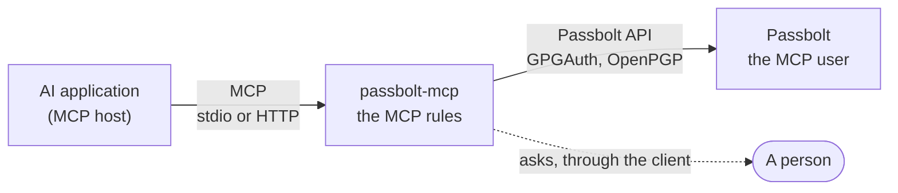

import DocCardList from '@theme/DocCardList';

# What is passbolt-mcp?

passbolt-mcp is an open-source [MCP](https://modelcontextprotocol.io) server that connects AI
applications to [Passbolt](https://www.passbolt.com), the open-source password manager for teams.

Using passbolt-mcp, AI applications like Claude Code, Claude Desktop, Cursor or VS Code can find
the credentials of a team, use them to do a task, rotate them and share them, without ever logging
in as a person. The agent works through a Passbolt user of its own, and within rules that you set.

Think of passbolt-mcp as a service account with a guard at the door. Passbolt decides what the
account can see. The guard, passbolt-mcp, decides what the agent may do with it, and can ask a
person before anything sensitive happens.

## What can passbolt-mcp enable?

- A coding agent can deploy to staging with the database password, without the password ever
  entering its context.
- A support assistant can answer "where is the login of the billing dashboard?" without being
  able to read a single password.
- An operations agent can rotate an expired password with a new one that follows the password
  policy of your organization, and say so in Passbolt.
- An agent can find every weak, expired or breached password in a folder and report what to do.
- An agent can prepare a share, show you who would gain access, and share only once you said yes.

## Why does passbolt-mcp matter?

Depending on who you are, passbolt-mcp has a range of benefits.

- **Security teams**: an agent never gets a person's account. It gets a Passbolt user with the
  role `user`, sees only what is shared with it, and everything it does shows in the Passbolt
  activity log under its name. Removing a share cuts it off at once.
- **Operators of agents**: rules in one file decide which tools the agent gets, in which folders,
  how often, and which calls a person must approve. Everything beyond reading is off by default.
- **Developers**: agents get the credentials they need for a task through a standard protocol,
  instead of secrets copied into prompts, environment files or chat histories.
- **End users**: an agent that can use a password for them, and can ask them before it deletes or
  shares anything.

## How it is built

passbolt-mcp is a single binary written in Rust. It uses
[`passbolt-sdk`](https://crates.io/crates/switch-case-passbolt-sdk) for the Passbolt API and
OpenPGP, and the official [Rust MCP SDK](https://github.com/modelcontextprotocol/rust-sdk) for the
protocol. It logs in as the Passbolt browser extension does (GPGAuth), encrypts and decrypts on
the client, and supports both v4 resources and v5 encrypted metadata. It is tested against a real
Passbolt server, through a real MCP client.

## Get started

<DocCardList
  items={[
    {
      type: 'link',
      href: '/getting-started/installation',
      label: 'Install',
      description: 'Install passbolt-mcp from a release, with Docker or from source.',
    },
    {
      type: 'link',
      href: '/getting-started/quick-start',
      label: 'Quick start',
      description: 'From nothing to an agent reading one folder of Passbolt, in five steps.',
    },
    {
      type: 'link',
      href: '/guides/serve',
      label: 'Connect a client',
      description: 'Claude Code, Claude Desktop, Cursor, VS Code, Codex, Docker and HTTP.',
    },
  ]}
/>

## Learn more

<DocCardList
  items={[
    {
      type: 'link',
      href: '/architecture',
      label: 'Architecture',
      description: 'The MCP user, the MCP rules, and what happens during a call.',
    },
    {
      type: 'link',
      href: '/security',
      label: 'Security',
      description: 'The attacks an agent with a password manager faces, and their mitigations.',
    },
    {
      type: 'link',
      href: '/secrets-without-seeing',
      label: 'Use a secret without seeing it',
      description: 'Handles and declared commands: the password never reaches the model.',
    },
  ]}
/>

## Project

<DocCardList
  items={[
    {
      type: 'link',
      href: '/roadmap',
      label: 'Roadmap',
      description: 'What passbolt-mcp does today, how it is tested, and what comes next.',
    },
    {
      type: 'link',
      href: '/contributing/development',
      label: 'Contributing',
      description: 'Build passbolt-mcp, run its tests, and work on it.',
    },
  ]}
/>

passbolt-mcp is licensed under the AGPL-3.0-or-later. The name "Passbolt" is a registered trademark
of Passbolt SA.
