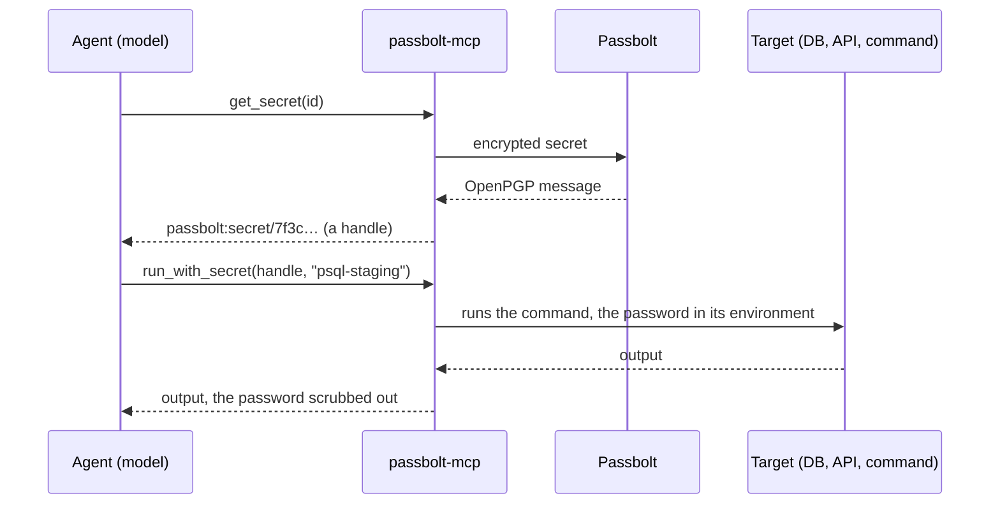

# Roadmap

What `passbolt-mcp` does today, how it is tested, and what comes next: first of all, letting an
agent **use** a password without **seeing** it.

## Today

| | |
|---|---|
| **The MCP user** | A Passbolt user of its own, role user, logged in with its OpenPGP key. It sees what is shared with it, nothing more; administrators are refused. |
| **The rules** | `[access]` (reading, secrets, writing, sharing; `allow_tools`, `deny_tools`), `[scope]` (folders), `[limits]` (calls and secrets per minute), `[audit]` (one JSON line per call, never a secret). |
| **The person in the loop** | `[confirm]`: the person says yes to each call of the tools listed, through the client; the agent cannot answer for them. |
| **The tools** | 27 tools: reading, secrets (`get_secret`, `get_totp_code`, `check_password_pwned`, `generate_password`), writing, sharing; MCP resources and prompts. See the [tools reference](tools-reference.md). |
| **Transports** | stdio; Streamable HTTP on loopback, which refuses browser pages (`Origin`). |

### Tested against a real Passbolt

Every feature runs against a real Passbolt server (ddev, `scripts/e2e.sh`), through a real MCP
client that starts the `passbolt-mcp` binary:

| Area | Tests |
|---|---|
| Login | the MCP user logs in with GPGAuth, the server proves its pinned key, the session is renewed when it ends; `passbolt-mcp verify` and `check` |
| Reading | resources, folders, folder tree, resource types, comments, permissions, search, favorites; MCP resources and prompts |
| Secrets | `get_secret` (password and note), `get_totp_code` (never the seed), `check_password_pwned`, `generate_password`; a secret read with every log at `trace` is in none of them |
| Writing | resources (name, username, URIs, description, note, expiry), folders (create, rename, move, delete with or without content), comments, favorites, `dry_run` |
| Sharing | `search_aros`, `simulate_share`, sharing and revoking resources and folders, moves that give a folder's permissions only with `access.share` |
| Rules | off by default; `allow_tools`, `deny_tools`; `scope.folders` on reads and writes; `limits`; the audit file |
| Confirm | accepted, declined, cancelled; protocol 2025-11-25 (`elicitation/create`) and 2026-07-28 (`input_required`); a client that cannot ask |
| HTTP | a client over Streamable HTTP; a request from a browser page refused |

The unit tests and a fake Passbolt cover the rest offline, on each pull request.

## Next

| | What | Why |
|---|---|---|
| **1** | [Secrets the agent uses without seeing them](#use-a-password-without-seeing-it) | The value never reaches the model, its context, its logs nor its provider. |
| **2** | Password generator following the organization's policy | `generate_password` follows the password policy of the server: length, character sets, passphrases, PIN codes; the strength said. |
| **3** | Distribution | crates.io, a Claude Desktop bundle (`.mcpb`), install buttons for Cursor and VS Code, a static Linux binary, Homebrew. |
| **4** | HTTP with a token | Streamable HTTP beyond loopback, behind `Authorization: Bearer`, for a server shared by agents; Docker with a token. |
| **5** | Profiles | One `passbolt-mcp` serving several agents, each with its MCP user and its rules (`--profile`). |
| **6** | Clients checked by hand | Claude Code, Claude Desktop, Cursor, VS Code: the configurations, and the confirmation questions as each client shows them. |

Later, in the SDK first: `passbolt-mcp init <invitation link>`, which generates the key of the
MCP user and activates it without a browser.

## Use a password without seeing it

> How can we make sure the agent doesn't see the password and can only use it?

Today, with `access.secrets`, `get_secret` returns the value: it lands in the context of the
agent, and may reach the model provider. The answer is to give the agent a **handle** to the
secret, never its value. The `passbolt-mcp` process is the only one that decrypts it, and it puts it
where it is needed.



### 1. Handles instead of values

With `access.mask_secrets = true`:

- `get_secret` and `generate_password` return an opaque handle, such as `passbolt:secret/7f3c…`,
  never the value.
- Handles live in the memory of `passbolt-mcp` only, expire after a few minutes, and are bound to
  the session: worthless anywhere else.
- `create_resource` and `update_resource` take a handle wherever they take a password. "Rotate this
  password" and "create the account with a generated password" work end to end, the value never in
  the conversation.

### 2. Using it outside Passbolt: `passbolt-mcp` acts, not the agent

| Way | How | Like |
|---|---|---|
| **Run a command** | `run_with_secret`: `passbolt-mcp` runs a command **declared in the configuration**, the secret in an environment variable. The agent picks a command; it cannot write one, so `echo $PASSWORD` is not an option. What the command prints is scrubbed of the secret (as is, base64, URL-encoded) before the agent reads it. | `op run` |
| **Render a template** | `passbolt-mcp` fills `{{ passbolt:<id> }}` in a configuration file the agent wrote. | `op inject` |
| **HTTP proxy** | The agent calls an API through `passbolt-mcp`, which adds the `Authorization` header. | a credential-injecting proxy |

```toml
[access]
secrets = true
mask_secrets = true

[commands.psql-staging]
run = ["psql", "-h", "db.staging", "-U", "agent", "-c", "{query}"]
env = { PGPASSWORD = "passbolt:Staging/DB" }
```

### 3. When a person must see it

MCP elicitation shows the value to the person, in the client, and not to the model: the channel
`[confirm]` already uses.

### What it does not guarantee

| Limit | What to do |
|---|---|
| An agent with a shell, as the same OS user as `passbolt-mcp`, can read its private key and bypass everything. | Run `passbolt-mcp` apart: the Docker image, or another OS user, the key unreadable by the agent. Required with `mask_secrets`. |
| A command that prints the secret transformed defeats the scrubbing. | Commands come from the configuration, never from the agent. |
| What the secret opens (a database session, an API token) is in the hands of the agent. | Masking protects the credential, not what it unlocks: Passbolt shares, `scope`, `[confirm]` and the audit still limit what it reaches. |

### Already there

- `[confirm]`: a person approves sensitive tools; the password and the note are never in the
  question.
- `access.secrets` off by default; `scope.folders` and `limits.secrets_per_minute` when on.
- The audit file records every read, never the value.
