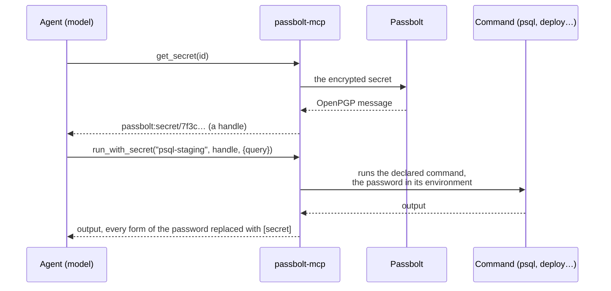

# Use a secret without seeing it

> How can we make sure the agent doesn't see the password and can only use it?

When an agent reads a password with `get_secret`, the value lands in its context. From there it
can reach the model provider, the conversation history and the logs of the client. This page
explains how passbolt-mcp lets an agent **use** a secret without ever **seeing** it.

The idea is simple: the agent gets a **handle** to the secret, never its value. passbolt-mcp is
the only process that decrypts the secret, and it puts it where it is needed itself.

| The agent needs to | It calls | The secret goes |
|---|---|---|
| Run a program with a password | [`run_with_secret`](#run-a-command-with-a-secret) | in the environment of a command you declared |
| Call an HTTP API with a token | [`call_api`](#call-an-api-with-a-secret) | in a header of a request to an API you declared |
| Write a configuration file | [`fill_template`](#fill-a-template) | in a file the agent cannot read |
| Store a new password | `create_resource`, `update_resource` | in Passbolt, through a [handle](#handles) |
| Give a password to the person | [`show_secret`](#show-a-secret-to-the-person-only) | to the person, in the client |



## Turn it on

Add `mask_secrets` to `[access]`, and declare the commands the agent may run in `[commands]`:

```toml
[access]
secrets = true
mask_secrets = true

[commands.psql-staging]
description = "Run a query on the staging database"
run = ["psql", "-h", "db.staging", "-U", "agent", "-c", "{query}"]
env = { PGPASSWORD = "{secret}", PGSSLMODE = "require" }

[commands.deploy]
description = "Deploy to an environment"
run = ["./deploy.sh", "{environment}"]
env = { DEPLOY_TOKEN = "passbolt:8f0b2c1e-5d1a-4e8b-9c3f-0a1b2c3d4e5f" }
timeout_seconds = 300
```

Then run `passbolt-mcp check`. It reminds you of the one thing this feature depends on:
[keeping the agent apart from passbolt-mcp](#keep-the-agent-apart-from-passbolt-mcp).

## Handles

With `access.mask_secrets = true`, the tools that would return a secret return a handle instead.

| Tool | Returns |
|---|---|
| `get_secret` | `handle` instead of `value`: `passbolt:secret/` followed by 32 hexadecimal characters. |
| `generate_password` | `handle` instead of `password`, with the strength of the password. |

The agent passes the handle wherever it would pass the secret:

| Tool | Takes a handle in |
|---|---|
| `create_resource` | `password`, `note` |
| `update_resource` | `password`, `note` |
| `run_with_secret` | `secret` |
| `call_api` | `secret` |
| `fill_template` | `{{ passbolt:secret/… }}` in the template |

This makes common tasks work end to end, the value never in the conversation:

- **"Rotate this password."** `generate_password` returns a handle, and `update_resource` stores
  the password it stands for.
- **"Create the account with a generated password."** The same, with `create_resource`.
- **"Run this query on staging."** `get_secret` returns a handle, and `run_with_secret` runs the
  command with the password.

### How handles are protected

- **Unguessable.** A handle holds 128 bits from the random generator of the operating system.
- **Short-lived.** A handle expires 15 minutes after it was made. An expired or unknown handle is
  refused, and the error never contains a secret.
- **Local.** Handles live in the memory of the passbolt-mcp process only, and the values behind
  them are wiped from memory when they are dropped. They are worth nothing to another
  passbolt-mcp, to Passbolt, or after a restart.
- **Not authentication.** A handle never replaces the rules. Every call that uses one is checked
  against the rules, the limits and `[confirm]` like any other.

:::note
Over Streamable HTTP, every client of one passbolt-mcp shares its handles, as they share the
session of the MCP user. They all act as the same MCP user with the same rules, so a handle gives
a client nothing it could not get itself. Run one passbolt-mcp per agent when agents must not
share anything.
:::

## Run a command with a secret

`run_with_secret` runs a command declared in `[commands]`, with a secret in its environment, and
returns what the command printed. It is offered when `access.secrets` is on and at least one
command is declared. `whoami` lists the commands, their arguments, and whether they take a secret.

| Argument | What |
|---|---|
| `command` | The name of a command of `[commands]`. |
| `secret` | A handle, or the id of a resource whose password the command gets. Only for commands whose `env` has `"{secret}"`. |
| `args` | The value of each `{placeholder}` of `run`, by name. |

### Declare a command

| Key | Default | What |
|---|---|---|
| `run` | Required | The program and its arguments. `{name}` is a placeholder the agent fills. |
| `env` | `{}` | Environment variables. `"{secret}"` is the secret the agent gives; `"passbolt:<id>"` is the password of that resource; any other value is used as is. |
| `description` | None | What the command does, for the agent. |
| `timeout_seconds` | `60` | The command is stopped after this time. |

### What the agent cannot do

- **Write a command.** The agent picks a command by name and fills its placeholders. passbolt-mcp
  runs the program directly, without a shell, so a placeholder value such as `; cat ~/.ssh/id_rsa`
  is one argument, not a second command.
- **Add arguments.** A placeholder the command does not declare is refused, and so is a missing
  one.
- **Read the secret from the command line.** passbolt-mcp refuses to start when `{secret}` or
  `passbolt:` appears in `run`: other processes on the machine can read the command line of a
  process, but not its environment.
- **Reach outside the scope.** A resource id, given by the agent or written in `env`, is read as
  the MCP user and within `scope.folders`, like any secret.
- **Give a secret to a command that takes none.** The call is refused.

### What comes back

| Field | What |
|---|---|
| `stdout`, `stderr` | What the command printed, with every secret it got replaced with `[secret]`. |
| `exit_code` | The exit code, or none when the command was stopped after its timeout. |
| `truncated` | `true` when an output was longer than 64 KiB and was cut. |

Before the output goes back to the agent, passbolt-mcp replaces each secret the command got with
`[secret]`, in every form a command commonly prints it:

- as is;
- in base64, standard and URL-safe, with and without padding;
- URL-encoded;
- in hexadecimal.

The command gets no input (stdin is empty), and inherits the environment of passbolt-mcp plus the
variables of `env`.

## Call an API with a secret

`call_api` sends an HTTP request to an API declared in `[apis]`, and puts the secret in a header
of the request. It is offered when `access.secrets` is on and at least one API is declared.

```toml
[apis.github]
description = "The GitHub API, as the deploy bot"
base_url = "https://api.github.com"
secret = "passbolt:8f0b2c1e-5d1a-4e8b-9c3f-0a1b2c3d4e5f"
headers = { Authorization = "Bearer {secret}", Accept = "application/vnd.github+json" }
methods = ["GET", "POST"]

[apis.status]
base_url = "https://status.example.com/api/v2/"
headers = { "X-Api-Key" = "{secret}" }
```

| Key | Default | What |
|---|---|---|
| `base_url` | Required | Every request goes under it. `https://`, or `http://` on a loopback address only, and no credentials in it. |
| `headers` | Required | The headers of each request. `{secret}` marks where the secret goes; at least one header has it. |
| `secret` | None | `"passbolt:<id>"`, the password of that resource. Without it, the agent gives a handle or a resource id in `secret`. |
| `methods` | `["GET"]` | The HTTP methods the agent may use. |
| `description` | None | What the API is for, for the agent, in `whoami`. |
| `timeout_seconds` | `30` | The request is abandoned after this time. |

The agent gives the name of the API, a `method`, a `path` under `base_url`, and optionally `query`
parameters and a JSON `body`. It gets the `status`, the `content_type` and the `body` back, with
the secret replaced with `[secret]`, cut at 64 KiB.

What the agent cannot do:

- **Leave the API.** The path must stay under `base_url`: an absolute path, `..`, another host or
  another scheme is refused.
- **Follow a redirect.** A redirect is never followed, so the secret never goes to the place it
  points to. The agent gets the status and the `location` instead.
- **Choose the headers.** Only the headers of the configuration are sent with the secret.
- **Use another method** than those of `methods`.

## Fill a template

`fill_template` writes a configuration file with secrets in it, from a template the agent wrote.
It is offered when `access.secrets` is on and at least one template is declared.

```toml
[templates.app-env]
description = "The .env of the app on staging"
source = "/srv/agent/app.env.template"
target = "/srv/app/.env"
```

The agent writes the `source` file, with a placeholder wherever a secret goes:

```bash
DATABASE_URL=postgres://app:{{ passbolt:8f0b2c1e-5d1a-4e8b-9c3f-0a1b2c3d4e5f }}@db.staging/app
API_TOKEN={{ passbolt:1c2d3e4f-5a6b-4c7d-8e9f-0a1b2c3d4e5f }}
SESSION_SECRET={{ passbolt:secret/7f3c0d1e2a4b5c6d7e8f9a0b1c2d3e4f }}
```

| Placeholder | Becomes |
|---|---|
| `{{ passbolt:<resource id> }}` | The password of that resource. |
| `{{ passbolt:<resource id>#<field> }}` | A field of its secret, such as `description` for the note of a v5 resource. |
| `{{ passbolt:secret/… }}` | The secret of a handle, from `get_secret` or `generate_password`. |

Any other `{{ … }}` is left as it is. passbolt-mcp then writes the `target` file, readable by its
owner only, replacing it at once so that it is never half written. If one placeholder cannot be
filled, nothing is written. The agent gets the target and the number of secrets, never the
content.

Both paths are absolute and set by the operator: the agent picks a template by name, and cannot
choose where the file goes. The `target` **MUST** be in a directory the agent cannot read;
otherwise, the agent can read the secrets back.

## Show a secret to the person only

Sometimes the person needs the password itself, for example to log in to a website by hand.
`show_secret` shows one field of the secret of a resource to the person, in the client, through
MCP elicitation. The model gets `shown: true`, never the value.

It needs a client that supports elicitation; with another client, the call is refused
(`unconfirmed`). Since the person sees the question anyway, `show_secret` is never asked again
through `[confirm]`.

:::warning
The client shows the value to the person in its own window. Depending on the client, it may stay
on screen, or in the history of the conversation, until the person closes it.
:::

## Keep the agent apart from passbolt-mcp

Masking holds only as long as the agent cannot reach what passbolt-mcp holds. An agent with a
shell, running as the same operating-system user as passbolt-mcp, can read the private key of the
MCP user and its passphrase, and decrypt everything itself.

With `mask_secrets`, you **MUST** run passbolt-mcp where the agent cannot read its files:

- as another operating-system user, the key and the passphrase readable by that user only; or
- in its [Docker image](guides/serve.md#with-docker), the configuration directory mounted for the
  container only.

`passbolt-mcp check` prints this reminder whenever `mask_secrets` is on.

## Limits

| Limit | What to do |
|---|---|
| An agent with a shell, as the same OS user as passbolt-mcp, bypasses everything. | [Keep the agent apart](#keep-the-agent-apart-from-passbolt-mcp). |
| A command that prints the secret transformed in another way (reversed, encrypted, one character per line) defeats the scrubbing. | Declare commands that do not print their secrets. The agent cannot change them. |
| What the secret opens, such as a database session, is in the hands of the agent. | Masking protects the credential, not what it unlocks. Passbolt shares, `scope.folders`, `[confirm]` and the audit still limit what it reaches. |
| `get_totp_code` returns the code itself. | A TOTP code is valid for seconds. Leave `get_totp_code` out with `deny_tools` if it matters. |
| A template whose target the agent can read gives the secrets back. | Put the targets of `[templates]` where the agent cannot read. |
| What an API returns can include data the secret protects. | Declare only the APIs, and the methods, the task needs. |
| Without `mask_secrets`, `get_secret` still returns values. | Turn `mask_secrets` on, or deny `get_secret` and let commands take resource ids. |

## Combine it with the other rules

- **`[confirm]`**: list `run_with_secret`, `call_api` and `fill_template` to approve each use. The
  question shows the arguments, never the secret.
- **`[limits]`**: these tools, and `show_secret`, count toward `secrets_per_minute`.
- **`[audit]`**: each use is one line, with the name of the command, API or template, the method
  and the path of an API call, never the output nor a secret.
